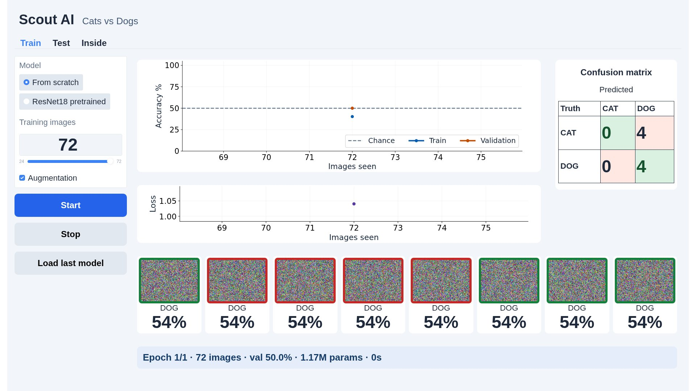
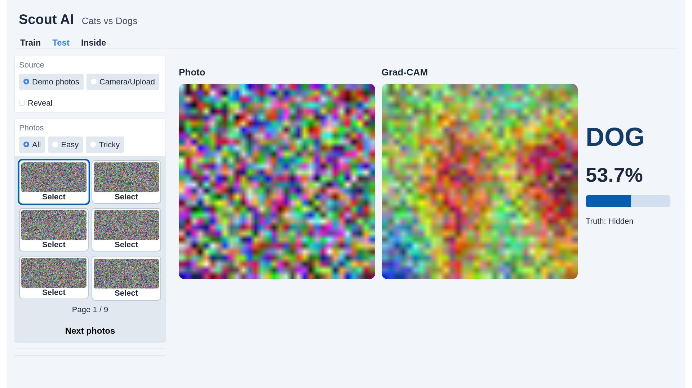
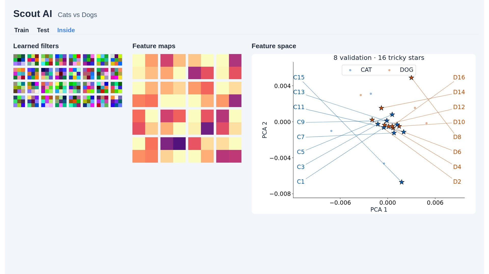

# Scout AI: Cats vs Dogs

[](https://colab.research.google.com/github/LaliChicken/Scout-CNN/blob/main/ScoutAI.ipynb)

A CNN feature-learning demo for scouts ages 11–17. Earlier, people chose features such as ears and whiskers. Here, the network learns filters from pixels and labels.

**Status:** the notebook's synthetic CPU smoke test passes. Real demo photos are awaiting the supplied zip files. Colab GPU preparation, training time, validation accuracy, and the real-photo exclusion audit have **not** been measured. The notebook deliberately stops if the 50 held-out photos are missing; it never silently trains on the demo set.

## Run the demo

1. Open the badge in Colab Pro and choose a **GPU** runtime. The notebook requests GPU hardware in its metadata; Colab controls allocation.
2. Choose **Runtime → Run all**. Config defaults are eight epochs, 128 px crops, and up to 12,500 source images per class. Setup installs pinned Gradio, clones this repo, downloads PetImages, prepares the data, and starts the app.
3. Open the printed share URL on the monitor and press **F11**. Use 1920×1080 at 100% browser zoom.
4. Click **Start** in Train. Test and Inside work after training or **Load last model**.

Optional `SHARE_PASSWORD` enables username `scouts` plus your password. Leave it empty for an unauthenticated share link. Do not save a real password in the committed notebook. Shares and `/content` checkpoints last only as long as the Colab runtime; copying `/content/checkpoints` to Drive preserves models across runtime deletion.

The primary dataset is Microsoft's `kagglecatsanddogs_5340.zip`. If download fails, the notebook searches an **already mounted** `/content/drive/MyDrive` for `Cat.zip` and `Dog.zip`. It does not interrupt Run all with an interactive Drive mount. Flat archives and archives containing Cat/Dog folders are supported.

## Live walkthrough

- **Model:** 25 visible lines. Four two-convolution blocks, 32/64/128/256 channels, BatchNorm, ReLU, max pool, global average pool, dropout 0.3, two logits. **1,173,730 parameters.** At 128 px, block shapes are `(B,32,64,64)`, `(B,64,32,32)`, `(B,128,16,16)`, `(B,256,8,8)`.
- **Training step:** 10 visible lines. Predict, measure cross-entropy, backpropagate, update weights. The UI calls this exact function.
- **Grad-CAM:** 20 visible lines. The final convolution's activations and score gradients produce a heat map. This indicates sensitivity of a class score; it does not prove the network understands an object.

All other code cells use collapsed Colab forms. The data cell ends with a labeled 4×8 training-photo grid.

For the overfitting demonstration, choose **From scratch**, **500** images, and turn **Augmentation** off. Watch the training/validation gap. Compare against augmentation on and then the full training set. Small-data runs use at least 40,000 image presentations so they have time to memorize; both augmentation settings use the same schedule. This behavior still needs confirmation on the supplied photos.

**ResNet18 pretrained** uses ImageNet weights. Only its new two-class head trains; backbone weights and BatchNorm statistics stay fixed. This is a different starting point from learning every filter from scratch.

## Held-out photos

Expected structure (50 JPG files total, exactly 16 in `tricky`):

```text
demo/
  cats/easy/*.jpg
  cats/tricky/*.jpg
  dogs/easy/*.jpg
  dogs/tricky/*.jpg
```

Use copies of PetImages photos, with correct class folders. `easy` and `tricky` are human choices, not promises about a particular trained model. The Test tab hides truth until **Reveal** is enabled and never sends source filenames to the browser. The gallery displays six photos per page. Inside uses `C1`, `D2`, etc. to label the sixteen tricky stars by class and ordinal.

Every source file is opened by PIL and converted to RGB in a multiprocessing pool using all CPUs. Empty, corrupt and non-image files are counted. Before capping or splitting, preparation removes exact SHA-1 matches and any 8×8 average-hash match with Hamming distance **≤5** to a demo photo. It rechecks the retained hashes and asserts zero matches. Both training and validation exclude the demo photos. Average hash is the specified exclusion rule, not a general guarantee against every possible transformed duplicate.

Preparation stores a single uint8 image tensor (shorter side resized to 144, center crop 144×144) and labels in RAM, then copies the complete data to the GPU. Fixed-seed stratified 90/10 split indices reference that tensor. Training uses GPU random crops/flips, normalization, AdamW and OneCycleLR, with bf16 autocast where supported and otherwise fp16 plus GradScaler. No DataLoader or `torch.compile` is used. Validation always uses center crops.

## Measured results

| Check | Result |
|---|---|
| CPU notebook smoke | Passed: 3 optimizer steps, Grad-CAM, checkpoint round-trip |
| Additional behavior tests | 5 passed: exclusion boundary/corruption, frozen transfer backbone, crops, Stop/empty model, archive safety |
| 1920×1080 browser screenshots | Passed: all three tabs, empty states, camera/upload and four-digit confusion counts; no page/panel scrolling |
| Full PetImages preparation | Not measured; real demo set pending |
| Demo photos remaining after prep | Not measured on real photos; synthetic test is not evidence of photo exclusion |
| Colab Pro GPU model / memory | Not measured |
| From-scratch full-data training time | Not measured; target 120–180 seconds, hardware dependent |
| Full-data validation accuracy | Not measured; target ≥90% |
| Small-data overfitting | Not measured on real photos |

The notebook writes actual preparation results to `/content/scout-ai/prep_report.json`. Each finished or stopped training run writes GPU name, configuration, preparation time, training wall time and validation accuracy to `/content/checkpoints/last_run.json`. Training wall time includes validation and live preview/UI updates, excludes initial setup and model/weight download, and synchronizes CUDA before reporting. A stopped run is labeled in its checkpoint metrics. Copy the measured full-run values into the table above after a Colab rehearsal; the 2–3 minute and 90% goals are **not claimed as achieved**.

## Checkpoints and privacy

`/content/checkpoints/last.pt` contains the model state, architecture/config and final metrics. **Load last model** reconstructs it without downloading ImageNet weights again. Saving uses a temporary file and atomic replacement. Restarting the Gradio UI preserves the checkpoint; restarting the entire Colab runtime may not.

Camera and upload controls decode/rescale images to at most 512 px **in the browser** and send image bytes in a textbox request. Python decodes them in memory; there is no Gradio image-upload component or `/upload` request. The app does not save frames, uploads, predictions, or flags to disk. The selected image stays in per-session RAM for up to one hour; the transport textbox is cleared after inference. Inline image data and SVG outputs avoid Gradio's image cache. Camera tracks stop after capture or when switching to Demo photos. Blocks has no flagging controls; public API links and the Gradio footer are hidden.

A shared GPU event queue serializes training, loading and explanation hooks. Stop bypasses that queue and stops at the next batch boundary, then validates and saves the partial model. Test/Inside requests made during training wait for the run to finish or stop.

## Development checks

The teaching app supports **Colab CUDA only**. CPU execution is limited to the explicitly requested synthetic smoke test and its developer browser fixture.

```bash
python -m pip install torch torchvision --index-url https://download.pytorch.org/whl/cpu
python -m pip install -r requirements-smoke.txt
SMOKE_TEST=1 jupyter nbconvert --execute ScoutAI.ipynb --to notebook --output /tmp/ScoutAI-smoke.ipynb
python -m pytest -q
```

Modern nbconvert requires an explicit `--to` format; omitting it fails in the CLI before it can execute any notebook code. The command above adds `--to notebook` to the requested smoke invocation.

The smoke path avoids network downloads, cloning, GPU allocation, ImageNet weights and launching/sharing. It uses 80 synthetic uint8 images, trains three batches, checks parameter changes, probabilities, Grad-CAM shape/range, split disjointness, confusion matrix and checkpoint restoration.

`ScoutAI.ipynb` is self-contained; the `notebook_cells/` files are its reviewable sources. After editing them, run `python tools/build_notebook.py`. The builder enforces the three teaching-cell line limits and clears execution output.

For browser checks, install Playwright Chromium, run `python tools/preview_ui.py`, then `python tools/check_browser.py` in another terminal. These screenshots use synthetic images and do not establish animal-classification quality. `train-layout-stress.jpg` substitutes four-digit matrix counts in the browser solely to test text fit; those are not measured predictions. The browser check exercises training, empty-model states, photo selection, Reveal, Inside and an upload; checks for console errors and `/upload` traffic; and asserts no page or panel scrolling at 1920×1080.

### Monitor captures

Synthetic CPU fixture; layout evidence only.






